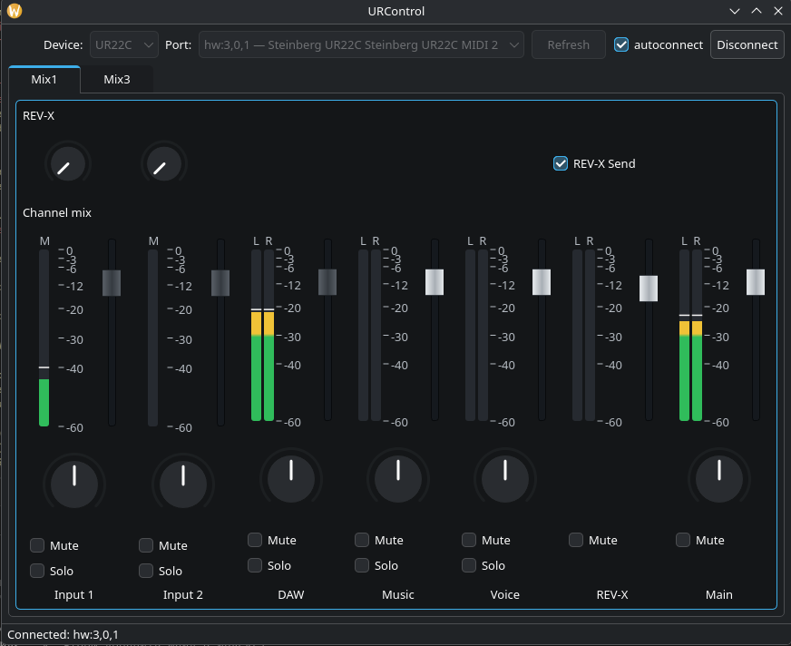

Language: [English](README.md) | [Русский](README.ru.md)

# URControl Qt - графический интерфейс управления аудиоинтерфейсами Steinberg UR-C

URControl Qt - приложение на C++17 и Qt Widgets, которое взаимодействует со встроенным DSP-микшером аудиоинтерфейса через **ALSA RawMIDI**.

Приложение предоставляет графический интерфейс для библиотеки [urcontrol-c](https://github.com/RE-Kovalev/urcontrol-c) и вдохновлено возможностями программного обеспечения Yamaha/Steinberg dspMixFx.

> **Статус проекта:** в разработке. Основная разработка и тестирование проводятся с **UR22C**. Другие модели серии UR-C доступны для выбора в конфигурации, однако их совместимость пока не проверена. Это независимый проект, не связанный со Steinberg или Yamaha.

## Скриншот



## Требования

- Linux с ALSA и доступом к устройству RawMIDI аудиоинтерфейса.
- Компилятор с поддержкой C++17, CMake версии 3.16 или новее и GNU Make (или совместимая реализация `make`).
- Пакеты разработки **Qt 6** с компонентами Widgets и LinguistTools.
- Заголовочные файлы и библиотека разработки ALSA (`libasound`).
- Библиотека [`urcontrol-c`](https://github.com/RE-Kovalev/urcontrol-c), подключённая как Git-подмодуль в `third-party/urcontrol-c`.

Проект CMake содержит некоторые механизмы совместимости с Qt 5, но в настоящее время **для сборки рекомендуется Qt 6**.

## Сборка

Клонируйте репозиторий вместе с подмодулем:

```bash
git clone --recurse-submodules https://github.com/RE-Kovalev/urcontrol-qt.git
cd urcontrol-qt
```

Настройте и соберите проект:

```bash
cmake -S . -B build -DCMAKE_BUILD_TYPE=Release
cmake --build build -j "$(nproc)"
```

Перед компоновкой Qt-приложения CMake собирает статическую библиотеку `urcontrol-c` с помощью её Makefile.

Запускайте приложение **из каталога сборки**, чтобы оно могло найти `devices.ini`:

```bash
cd build
./urcontrol-qt
```

## Начало работы

1. Подключите аудиоинтерфейс UR-C к компьютеру.
2. Запустите URControl Qt и выберите **модель устройства**.
3. Выберите **MIDI-порт управления внутренним микшером** аудиоинтерфейса, а не внешний порт MIDI DIN.
4. Нажмите **Connect** и дождитесь завершения первоначального чтения параметров.
5. Настраивайте доступные элементы управления каналами. Изменения передаются устройству через MIDI SysEx.

Посмотреть список MIDI-устройств ALSA можно командой:

```bash
amidi -l
```

или:

```bash
./urcontrol-cli --get-midi-ports
```

Некоторые аудиоинтерфейсы предоставляют несколько MIDI-подустройств. Нужный порт зависит от оборудования и нумерации устройств ALSA; не следует рассчитывать, что пример вроде `hw:3,0,1` подойдёт для вашей системы.

Опция **Auto-connect** позволяет приложению при запуске попытаться повторно подключиться к ранее выбранному порту.

## Конфигурация

Файл `devices.ini` задаёт модели аудиоинтерфейсов, доступные для выбора, и количество отображаемых входных каналов. Например:

```ini
[UR22C]
Inputs=2

[UR44C]
Inputs=6
```

Приложение читает `devices.ini` из **текущего рабочего каталога**. В существующей реализации модели с более чем шестью входами не добавляются в список выбора, даже если они указаны в конфигурационном файле.

Локальный файл `lasts` хранит выбранную модель устройства, MIDI-порт и настройку автоматического подключения. Эти файлы читаются и записываются в рабочем каталоге; использование общесистемного расположения настроек пока не реализовано.

## Лицензия и авторство

Лицензия MIT. См. информацию о лицензии в репозитории.

**Steinberg**, **Yamaha**, **UR-C** и **dspMixFx** являются товарными знаками соответствующих правообладателей.
